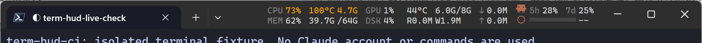
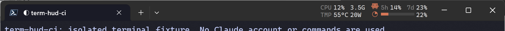

# term-hud

[English](#english) · [中文](#中文)

A tiny resource monitor that lives in the empty space of the Windows Terminal title bar, between the tabs and the window buttons.

一个嵌在 Windows Terminal 标题栏空白处（标签和窗口按钮之间）的资源监视器。





---

## English

### What it shows

- **CPU**: utilization (same source as Task Manager), hottest core temperature, current frequency. Turns orange and prefixes the frequency with `↓` when the CPU is power or thermal limited, or at 90 °C or above.
- **MEM**: usage percent, used / total.
- **GPU** (NVIDIA only): utilization, temperature, VRAM used / total.
- **DSK**: active time, read and write rate.
- **NET**: download, upload, link speed.
- **Claude Code** (only when the selected tab is Claude Code): a one-line Clawd icon, 5-hour and 7-day usage of the default `~/.claude` account, and the session's progress toward auto-compact as a pie, a bar and a percentage. Usage turns red at 95% and shows the reset time; expired windows show `N/A`.

Layout is density first: entries are paired into two-row columns (CPU over MEM, GPU over DSK), and when space runs out they are dropped one at a time, lowest priority first (NET, DSK, MEM, Claude, GPU, CPU). Data refreshes every 3 seconds.

With several Windows Terminal windows open, the full HUD goes on the largest one (ties go to the top-right one). Any other window whose selected tab is Claude Code shows its own Claude column.

### Install

Paste into PowerShell (Windows PowerShell or PowerShell 7, no admin needed):

```powershell
irm https://raw.githubusercontent.com/Yongzhaooo/term-hud/main/install.ps1 | iex
```

The script:

1. installs PowerShell 7 with winget if it is missing;
2. downloads `term-hud.ps1` to `%LOCALAPPDATA%\term-hud\app`, adds a Startup shortcut so it runs at login without a console window, and starts it;
3. installs and sets up LibreHardwareMonitor (see below). This is the only step that shows a UAC prompt.

Options and uninstall:

```powershell
& ([scriptblock]::Create((irm https://raw.githubusercontent.com/Yongzhaooo/term-hud/main/install.ps1))) -NoLHM       # skip LibreHardwareMonitor
& ([scriptblock]::Create((irm https://raw.githubusercontent.com/Yongzhaooo/term-hud/main/install.ps1))) -Uninstall   # remove term-hud and its LHM logon task
```

Run the install command again to update.

### Requirements

| Needed for | Dependency | Installed by the script |
|---|---|---|
| Everything | Windows 10 / 11 with winget, [Windows Terminal](https://aka.ms/terminal) | No, both ship with Windows 11 |
| Everything | [PowerShell 7](https://aka.ms/powershell) | Yes |
| CPU temperature and package power | [LibreHardwareMonitor](https://github.com/LibreHardwareMonitor/LibreHardwareMonitor) (LHM) | Yes, unless `-NoLHM` |
| GPU column | NVIDIA driver (`nvidia-smi`) | No |
| Claude column | [Claude Code](https://docs.anthropic.com/en/docs/claude-code) logged in with the default `~/.claude` config | No |

Missing sources just show `--`; everything else keeps working.

### LibreHardwareMonitor

Windows does not expose CPU temperature to normal programs, so term-hud reads it from LHM's local web server at `http://127.0.0.1:8085/data.json`. LHM needs **administrator rights** to read the sensors. Without it, temperature and power show `--`.

The installer sets LHM up like this:

- `winget install LibreHardwareMonitor.LibreHardwareMonitor`;
- in `LibreHardwareMonitor.config` next to the exe: web server on, port 8085, start minimized, minimize and close to the tray;
- a scheduled task `term-hud LibreHardwareMonitor` that starts LHM at logon with highest privileges, so there is no UAC prompt at every boot.

To set it up by hand instead: install LHM, run it as administrator, turn on **Options → Remote Web Server → Run** (port 8085), and tick **Options → Run On Windows Startup**.

### Run from source

```powershell
git clone https://github.com/Yongzhaooo/term-hud.git
cd term-hud
pwsh -NoProfile -File .\term-hud.ps1          # runs in the foreground; only one instance at a time
pwsh -NoProfile -File .\term-hud.ps1 -Test    # self-test of the pure logic
```

### Use

- **Right-click** the HUD to toggle entries, pick which disks and network adapters to count, turn on "Always on top", or exit. Choices are saved in `%APPDATA%\term-hud\settings.json`. Menus follow the system UI language (Chinese or English).
- **Drag** the HUD to move the terminal; **double-click** to maximize or restore it.
- By default the HUD only shows while the title bar is visible, and hides while the window is being dragged or resized.
- The last timer error, if any, is written to `%LOCALAPPDATA%\term-hud\error.log`.

### Privacy

- The Claude column first reads the usage that Claude Code itself caches in `~/.claude.json`, so normally no request is made. Only when that cache is older than 5 minutes does it call `api.anthropic.com/api/oauth/usage` with the token from `~/.claude/.credentials.json`. That call costs no tokens; it backs off up to 30 minutes when rate limited. The token is sent nowhere else and is never stored or refreshed by term-hud. No Claude Code settings are changed.
- Context usage is read from the tail of the session transcripts in `~/.claude/projects/`.
- LibreHardwareMonitor's web server listens on all interfaces, so other machines on your network can read the sensor data. Add a firewall rule if that matters to you.

### Performance

Measured on 2026-10-14 over 3 minutes of normal use, sampled once per second (158 s with the HUD shown, 26 s hidden):

| | HUD shown | HUD hidden |
|---|---|---|
| CPU, share of one core | 2.5% | 2.4% |
| CPU, share of the whole machine (24 logical CPUs) | 0.11% | 0.10% |
| Working set / private memory | 272 MB / 136 MB | 268 MB / 137 MB |

- The `nvidia-smi -lms 3000` child process adds about 32 MB and no measurable CPU.
- 27 threads. Most of the memory is the PowerShell 7 runtime itself.
- Test machine: i7-13700K, 64 GB, RTX 5060, PowerShell 7.6.6, Windows Terminal 1.24.12741.0, 3840×2160 at 225%.
- Why it stays light: resource data is sampled every 3 s; layout is redone only when the window, tabs, settings or data change; tab positions are queried through UI Automation only when the window size, DPI or title changes (with a 10 s fallback), never while dragging; session files are re-read only when their modification time changes.
- In the full UI test, the HUD reappeared 732 ms after a title-bar drag ended and 1087 ms after a drag started from the HUD.

### Known issues

- Dragging the terminal window can still feel a bit laggy.
- Detecting which terminal window to attach to, and where its tabs end, is still not very reliable.
- Windows only. It depends on Windows Terminal, PowerShell 7, Win32 / UI Automation, Windows performance counters, and optionally LibreHardwareMonitor and `nvidia-smi`. Cross-monitor DPI changes have not been tested on real hardware.

### Contributing

Help is very welcome: bug reports, fixes, and ideas. Porting it to Linux (or to other terminals) would be great too. Pull requests are welcome.

Before sending a PR:

```powershell
pwsh -NoProfile -File scripts/ci.ps1          # fast tier: pure logic, native compile, regressions
pwsh -NoProfile -File scripts/ci.ps1 -Full    # full tier: real Windows Terminal UI checks
```

The full tier opens its own `term-hud-ci` terminal window with isolated settings and fake usage data (no Claude account is used). Leave the mouse alone for about 30 seconds while it runs. Logs and screenshots go to `build/ci/`. `git config core.hooksPath .githooks` runs the fast tier before each commit and the full tier before each push.

The product spec, in Chinese, is in [docs/product.md](docs/product.md).

### License

[GPL-3.0](LICENSE). Copyright © 2026 Yongzhao Chen.

---

## 中文

### 显示内容

- **CPU**：总占用（与任务管理器同源）、核心最高温度、当前频率。被功耗或温度限制、或温度达到 90 °C 时变橙，频率前加 `↓`。
- **MEM**：占用百分比、已用 / 总量。
- **GPU**（仅 NVIDIA）：占用、温度、显存已用 / 总量。
- **DSK**：活动时间、读写速率。
- **NET**：下行、上行、链路速率。
- **Claude Code**（仅当选中的标签是 Claude Code）：一行高的 Clawd 图标，默认 `~/.claude` 账户的 5 小时和 7 天额度，以及当前会话距自动压缩的进度（饼图、长条和百分比）。额度达到 95% 时标红并显示重置时间，已过期显示 `N/A`。

布局以信息密度优先：条目两两叠成两行一列（CPU 叠 MEM，GPU 叠 DSK）。空间不够时按优先级从低到高逐条收起：NET、DSK、MEM、Claude、GPU、CPU。数据每 3 秒刷新一次。

开着多个 Windows Terminal 窗口时，完整 HUD 显示在最大的那个上，面积相近时选最靠右上角的。其他窗口如果选中的是 Claude Code 标签，会单独显示自己的 Claude 列。

### 安装

在 PowerShell 里粘贴运行（Windows PowerShell 或 PowerShell 7 都行，不需要管理员）：

```powershell
irm https://raw.githubusercontent.com/Yongzhaooo/term-hud/main/install.ps1 | iex
```

脚本会做三件事：

1. 没有 PowerShell 7 时用 winget 安装；
2. 把 `term-hud.ps1` 下载到 `%LOCALAPPDATA%\term-hud\app`，在“启动”文件夹建快捷方式（登录后自动运行，不弹控制台窗口），并立即启动；
3. 安装并配置 LibreHardwareMonitor（见下文）。只有这一步会弹一次 UAC。

选项与卸载：

```powershell
& ([scriptblock]::Create((irm https://raw.githubusercontent.com/Yongzhaooo/term-hud/main/install.ps1))) -NoLHM       # 不装 LibreHardwareMonitor
& ([scriptblock]::Create((irm https://raw.githubusercontent.com/Yongzhaooo/term-hud/main/install.ps1))) -Uninstall   # 卸载 term-hud 及其 LHM 登录任务
```

更新：重新运行安装命令即可。

### 依赖

| 用途 | 依赖 | 安装脚本是否代装 |
|---|---|---|
| 全部功能 | 带 winget 的 Windows 10 / 11、[Windows Terminal](https://aka.ms/terminal) | 否，Windows 11 自带 |
| 全部功能 | [PowerShell 7](https://aka.ms/powershell) | 是 |
| CPU 温度和封装功耗 | [LibreHardwareMonitor](https://github.com/LibreHardwareMonitor/LibreHardwareMonitor)（LHM） | 是，除非加 `-NoLHM` |
| GPU 列 | NVIDIA 驱动（`nvidia-smi`） | 否 |
| Claude 列 | 已登录的 [Claude Code](https://docs.anthropic.com/en/docs/claude-code)，使用默认的 `~/.claude` 配置 | 否 |

缺少某个数据源时，对应格子显示 `--`，其他条目照常工作。

### LibreHardwareMonitor

Windows 不向普通程序开放 CPU 温度，term-hud 通过 LHM 的本地 Web 服务 `http://127.0.0.1:8085/data.json` 读取。LHM 需要**管理员权限**才能读传感器；没有它时，温度和功耗显示 `--`。

安装脚本对 LHM 的配置：

- `winget install LibreHardwareMonitor.LibreHardwareMonitor`；
- 修改 exe 旁的 `LibreHardwareMonitor.config`：开启 Web 服务、端口 8085、启动时最小化、最小化和关闭都缩到托盘；
- 注册计划任务 `term-hud LibreHardwareMonitor`，登录时以最高权限启动 LHM，之后每次开机不再弹 UAC。

也可以手动配置：安装 LHM，以管理员身份运行，开启 **Options → Remote Web Server → Run**（端口 8085），再勾选 **Options → Run On Windows Startup**。

### 从源码运行

```powershell
git clone https://github.com/Yongzhaooo/term-hud.git
cd term-hud
pwsh -NoProfile -File .\term-hud.ps1          # 前台运行，同时只允许一个实例
pwsh -NoProfile -File .\term-hud.ps1 -Test    # 自检纯逻辑
```

### 操作

- **右键** HUD：勾选要显示的条目，选择统计哪些磁盘和网卡，开关“始终显示（置顶）”，或退出。设置保存在 `%APPDATA%\term-hud\settings.json`。菜单按系统界面语言显示中文或英文。
- 在 HUD 上**拖动**可以移动终端窗口，**双击**最大化或还原。
- 默认只在标题栏可见时显示，拖动或缩放窗口期间隐藏。
- 定时器的最近一次异常写在 `%LOCALAPPDATA%\term-hud\error.log`。

### 隐私

- Claude 列优先读取 Claude Code 自己缓存在 `~/.claude.json` 里的用量，通常不发任何请求。缓存超过 5 分钟时，才用 `~/.claude/.credentials.json` 里的令牌请求一次 `api.anthropic.com/api/oauth/usage`。这个请求不消耗 token，被限流时逐次退避，最长 30 分钟。令牌不会发往其他地方，term-hud 也不保存、不刷新令牌，不改动 Claude Code 的任何设置。
- 上下文用量读取自 `~/.claude/projects/` 下会话记录的尾部。
- LibreHardwareMonitor 的 Web 服务监听所有网卡，同一网络里的其他设备能读到传感器数据。介意的话请自行加防火墙规则。

### 性能

2026-10-14 在日常使用中连续采样 3 分钟，每秒一次（HUD 显示 158 秒，隐藏 26 秒）：

| | HUD 显示 | HUD 隐藏 |
|---|---|---|
| CPU，占单核 | 2.5% | 2.4% |
| CPU，占整机（24 个逻辑处理器） | 0.11% | 0.10% |
| 工作集 / 专用内存 | 272 MB / 136 MB | 268 MB / 137 MB |

- `nvidia-smi -lms 3000` 子进程另占约 32 MB 内存，CPU 占用低到测不出。
- 共 27 个线程。内存大头是 PowerShell 7 运行时本身。
- 测试机：i7-13700K、64 GB、RTX 5060、PowerShell 7.6.6、Windows Terminal 1.24.12741.0，3840×2160、225% 缩放。
- 保持轻量的做法：资源数据每 3 秒采一次；只在窗口、标签、设置或数据变化时重新排版；标签位置只在窗口尺寸、DPI 或标题变化时经 UI Automation 重查（10 秒兜底），拖动中不查；会话文件只在修改时间变化时重读。
- 完整 UI 测试中，从标题栏拖动结束后 732 ms、从 HUD 上拖动结束后 1087 ms，HUD 重新出现。

### 已知问题

- 拖动终端窗口时仍有些卡顿。
- 自动识别该挂在哪个终端窗口、以及标签栏右边界的准确度还不够好。
- 只支持 Windows：依赖 Windows Terminal、PowerShell 7、Win32 / UI Automation、Windows 性能计数器，可选依赖 LibreHardwareMonitor 和 `nvidia-smi`。跨显示器 DPI 切换还没在真机上测过。

### 参与开发

欢迎一起完善：报 bug、修问题、提想法都可以。也非常欢迎把它移植到 Linux 或其他终端上。欢迎 PR。

提交 PR 前请跑一下本地 CI：

```powershell
pwsh -NoProfile -File scripts/ci.ps1          # fast：纯逻辑、原生代码编译、回归检查
pwsh -NoProfile -File scripts/ci.ps1 -Full    # full：在真实 Windows Terminal 上做 UI 检查
```

full 会打开一个独立的 `term-hud-ci` 终端窗口，使用隔离的设置和模拟额度，不使用任何 Claude 账户。运行的大约 30 秒内请不要动鼠标。日志和截图在 `build/ci/` 下。执行 `git config core.hooksPath .githooks` 后，每次提交前会自动跑 fast，推送前跑 full。

产品 spec 见 [docs/product.md](docs/product.md)（中文）。

### 许可证

[GPL-3.0](LICENSE)。Copyright © 2026 Yongzhao Chen。
